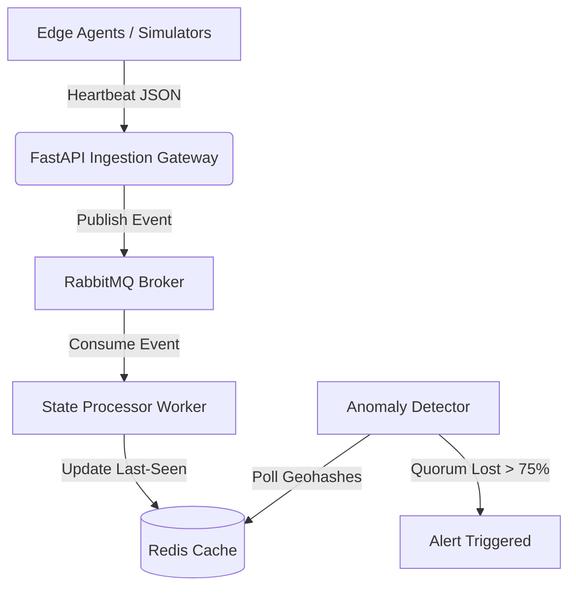

# Resilient Utility Grid Telemetry Monitor ⚡️

A high-throughput, fault-tolerant telemetry ingestion system designed to map utility outages (power, water) in zero-infrastructure environments by monitoring edge-client heartbeats in real-time.

## 📖 The Problem
In emerging markets with unstable utility infrastructure, power outages are localized, unpredictable, and lack official APIs. Relying on manual social media reports is slow and inaccurate.

## 💡 The Solution
This system ingests heartbeat signals from distributed edge clients (smartphones, IoT devices). By applying spatial thresholding and quorum-sensing algorithms, the system differentiates between individual device drop-offs (e.g., dead battery) and true geographic grid failures, triggering localized alerts automatically.

## 🏗️ System Architecture

